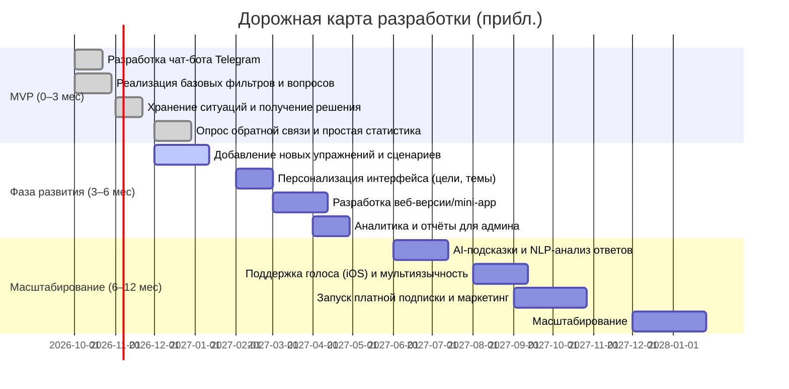

# Краткое содержание  
**Цель:** Анализ рынка мини-приложения/бота для психологической рефлексии. В отчёте рассмотрены популярные упражнения для самоанализа, их эффективность и риски, конкурентная среда (не менее 8 приложений/ботов), спрос и тренды, а также рекомендации по MVP, монетизации и тестированию.  

**Выводы:** Регулярная рефлексия документируется в исследованиях как повышающая эффективность (например, ежедневные 15-минутные рефлексии улучшали производительность на ~23%) и эмоциональную осознанность (интерактивное ведение дневника с обратной связью увеличивало её на 34%). Приложения для дневников и трекинга настроения (напр. Daylio, Reflectly, Journey) подтверждают востребованность: средний доход «рефлексивных» приложений ≈$279 000/мес при ~74 000 установок. Конкурентные продукты предлагают: структурированные дневники (Grid Diary), AI-направленные подсказки (Empath, Reflectly, Rosebud), трекинг настроения и активностей (Daylio, Reflexy), статистику и графики (Journey, Reflexy). Пользователи ценят простоту ввода (иконки настроения, голосовой ввод), персонификацию целей и задаваемых вопросов. 

**Рекомендации:** MVP-версия как Telegram-бота включает: настройку 2–3 долгосрочных целей, ввод ситуации, выбор одного из фильтров решений (работа/близкие/друзья) и набор вопросов (3–5), мягкое резюме и фиксирование решения, постфактум опрос через несколько дней по краткому шаблону (что получил/потратил, эмоции). Обязательны механики обратной связи (уведомления и простая статистика отказов/соглашений). Для безопасности — минимальный сбор данных, локальное/шифрованное хранение записей, возможность удаления; явные disclaimers («не терапия, при тяжёлых состояниях обратитесь к специалисту»). 

**Тестирование и развитие:** Выдвигаем гипотезы: *“Структурированные вопросы повышают удовлетворённость принятым решением”*, *“Персонификация по целям увеличивает вовлечение”*. Метрики успеха: дневная/недельная активность, доля повторных пользователей, отклики на опросы. Планируется A/B-тестирование вариантов интерфейса (например, формулировка вопросов, частота напоминаний). Дорожная карта: «3 мес» – разработать базовые фильтры и статистику; «6 мес» – добавить новые упражнения и мультиязычный контент; «12 мес» – внедрить AI-подсказки, мультиплатформенность.  

*(Далее – детальный анализ.)*  

## Практики и упражнения для рефлексии  
**Саморефлексия** – осознанный разбор своих действий, чувств и ценностей, ведущий к личному росту. Ключевые приёмы: **ведение дневника** и **задание направляющих вопросов**. Журнал самочувствия и чувств помогает «упорядочить мысли и посмотреть на них со стороны». Исследования показывают, что регулярные записи (5–10 мин в день) укрепляют этот навык и ускоряют извлечение уроков.  

- **Дневник настроения/событий.** Пользователь ежеднено помечает своё настроение (или эмоцию) и кратко описывает ключевое событие или мысль. Например, как в приложении Daylio: выбор иконки настроения и списка дел («занятия, хобби, физическая активность»), с построением статистики в виде графиков. Такая практика помогает «замечать эмоции и точку их зарождения», а затем эффективнее с ними справляться. Длительность: ~2–5 мин/день. Частота: ежедневно/несколько раз в день. **Метрики:** количество записей, динамика настроения, разнообразие занятостей. **Риски:** возрастание тревожности при фиксации негативных чувств, возможная перегрузка информацией. **Персонализация:** возможность задавать собственные категории (теги #здоровье, #работа и т.д. как в Diaro), выбор максимального объема текста (микродневник vs. развернутый).  

- **«ABC-дневник» (CBT-модель Эллиса).** Пользователь фиксирует: A – активирующее событие, B – свои мысли/убеждения, C – последствия (чувства и поведение). Это известная когнитивно-поведенческая техника. Например: событие – разговор с руководителем, мысли – «она меня недооценивает», последствия – раздражение и снижение эффективности. Далее следует разобрать мысль (рационализация) и выбрать продуктивную установку. **Цель:** выявить и скорректировать искажённые мысли. **Метрики:** повышение позитивности взглядов (оценка до/после), снижение частоты негативных мыслей. **Риски:** может обострять переосмысление негативных ситуаций, требует навыков критического мышления. **Персонализация:** подсказки типовых когнитивных искажений, чек-лист (силлабусы) для автоматической помощи в распознавании искажений.  

- **«Где в этом есть Я?»** (*гипотеза формулировки*, хотя явного источника нет). Задача – определить, насколько ситуация связана с личными ценностями, интересами или задачами пользователя. В чат-боте это может звучать: «Что в этой просьбе/ситуации важно лично для тебя?». Это помогает отличить истинные желания от внешних обязательств. Например, при приглашении на мероприятие задуматься: «Есть ли у меня интерес или польза от участия, или я делаю это из долга?». **Цель:** отыскать «звоночек» собственных интересов в событии. **Метрики:** доля случаев, когда осознание «собственной выгоды» приводило к отказу и улучшенной удовлетворённости решением. **Риски:** может спровоцировать эгоцентричные оценки; важен мягкий тон, чтобы не усилить вину от отказа. **Персонализация:** примеры вопросов под разные отношения (работа/друзья/семья) и предпочтения по времени/ресурсам пользователя.  

- **Колесо баланса («Wheel of Life»).** Пользователь оценивает несколько сфер жизни (здоровье, работа, отношения, отдых и т.д.) по шкале. Затем описывает, какие шаги предпринять, чтобы сбалансировать низкие оценки. **Цель:** увидеть дисбаланс и мотивировать изменения. **Метрики:** изменения в оценках через месяц. **Риски:** сильная фрустрация при низких оценках. **Персонализация:** гибкий набор сфер, настраиваемый пользователем.  

- **Генератор вопросов.** Бот может предлагать сильные открытые вопросы для углублённой рефлексии (пример из РБК: «Что для меня действительно важно?», «Какой урок я извлек из этой ситуации?»). **Цель:** стимулировать самоанализ. **Метрики:** рост количества уникальных записей и глубина ответов. **Риски:** при частом использовании возможна усталость от переосмысления. **Персонализация:** набор вопросов по темам или циклам (утро/вечер, неделя, перед сном).  

- **Список достижений.** Регулярная фиксация ежедневных успехов (даже маленьких) для развития позитивной рефлексии. Бот напоминает спросить «Что получилось хорошо?». **Цель:** повышение самооценки и мотивации. **Метрики:** число позитивных записей, рост самооценки. **Риски:** возможное игнорирование (при депрессии тяжело вспомнить успехи). **Персонализация:** категории достижений (работа, личное, здоровье).  

- **Обратная связь от других.** Пользователь формулирует ситуацию, в которой хочет мнение окружающих: бот предлагает способ попросить отклик («Если бы вы видели меня в такой ситуации, какой бы совет дали?»). **Цель:** расширить перспективу, уменьшить когнитивные искажения. **Метрики:** динамика чувств при получении обратной связи. **Риски:** неправильный подход – нельзя публиковать личные данные. В боте возможно только теоретическое моделирование. **Персонализация:** примеры «деликатных» вопросов для разных контекстов (работа, семья).  

- **Практика осознанного дыхания.** Короткие медитации с фокусом на теле и чувствах. После сеанса бот предлагает записать, какие эмоции заметил во время дыхания. **Цель:** снять стресс и повысить осознанность текущих ощущений. **Метрики:** снижение уровня тревожности (опросник) и частота практик. **Риски:** минимальны, но нужна опция пропустить, если неудобно. **Персонализация:** выбор продолжительности (1–5 мин), голосовые/текстовые подсказки.  

- **Журнал благодарности.** Пользователь перечисляет 1–3 вещи, за которые благодарен сегодня. Бот ведёт статистику частоты упоминаний (напр., «семья», «здоровье»). **Цель:** смещение фокуса на позитив и ресурсы. **Метрики:** увеличение положительных записей, рост субъективного благополучия. **Риски:** формализм может свести к однообразию. **Персонализация:** темы благодарности (личные, профессиональные и т.д.).  

- **«5 почему».** Пользователь рассматривает ситуацию или тревожную мысль и последовательно спрашивает себя «Почему?» несколько раз, чтобы добраться до коренных причин. Бот ведёт диалог: на каждый ответ – новый «почему». **Цель:** понять глубокие мотивации и страхи. **Метрики:** способность формулировать более осознанные цели. **Риски:** может погружать в негатив («бесполезно, потому что бессмысленно…»), нужно осторожно завершить цикл. **Персонализация:** задавать менее или более глубинные «почему» в зависимости от запроса.  

- **Визуализация идеального дня/сценарий.** Бот предлагает представить желаемую ситуацию (работа, отдых, отношения) и записать детали: что происходит, как чувствуешь себя, что делаешь. **Цель:** прояснить цели и желания, мотивировать изменения. **Метрики:** согласованность повседневных целей. **Риски:** риск разочарования при сильной разнице реальности и мечты. **Персонализация:** подсказки в зависимости от текущих приоритетов пользователя (красота, карьера, здоровье и т.д.).  

- **Анализ нереализованных ожиданий.** После события пользователь записывает свои чувства и сравнивает их с первоначальными ожиданиями: «Что я ожидал? Что произошло? Почему возникла разница?» **Цель:** учиться регулировать ожидания и эмоции. **Метрики:** снижение частоты негативных эмоций от неудовлетворённости. **Риски:** возможная зацикленность на прошлых ошибках. **Персонализация:** учитывать индивидуальный стиль реагирования (например, тревожный/оптимистичный).  

Таблица ниже обобщает дополнительные упражнения:

| Упражнение                    | Цель                                                | Пример сценария / вопросы             | Длительность / частота    | Оценка эффективности         | Риски/примечания       | Персонализация                   |
|-------------------------------|----------------------------------------------------|--------------------------------------|---------------------------|-----------------------------|-----------------------|----------------------------------|
| Дневник настроения/активностей| Отслеживать настроение и поведение, видеть закономерности| Выбор иконки «настроения», описание важных событий дня| 3–5 мин ежедневно| Частота позитивных дней, корреляция активности и настроения| Конфиденциальность, фиксация негатива| Настраиваемые теги/категории (спорт, работа и пр.) |
| ABC-дневник (КПТ)             | Выявлять и корректировать иррациональные мысли| A: ситуация, B: мысли, C: чувства/действия| 5–10 мин при стрессовых событиях| Снижение интенсивности негативных автоматических мыслей| Усиление зацикленности на проблеме, требует навыка| Подсказка когнитивных искажений, образцы продуктивных установок |
| «Где в этом Я?»               | Определять личную значимость события              | «Что в этой ситуации важно лично для меня?»       | 1–3 мин при принятии решения| Улучшение качества решений, рост самосознания| Эгоцентризм, чувство вины при отказе| Фильтрация по ролям (работа, семья, друзья) |
| Колесо баланса                | Баланс сфер жизни                                 | Оценить здоровье, работу, отношения от 1 до 10| Однократно с повтором раз в квартал| Изменение оценок, действия по исправлению дисбаланса| Негативные эмоции от низких оценок| Подбор сфер по предпочтениям пользователя |
| Рефлексивные вопросы (CBT)    | Глубокий анализ убеждений                         | «Почему я так думаю?», «Как иначе можно взглянуть?»| 5 мин (ежедневно/по необходимости)| Качество ответов, осознание шаблонов мышления| Перегрузка умственной активностью| Набор вопросов по теме (самооценка, конфликт и т.д.) |
| Обратная связь               | Получать альтернативную точку зрения              | «Как бы вы поступили на моём месте?»| 5 мин (по желанию)| Изменение самовосприятия, снижение искажений| Риск озабоченности мнением окружающих| Имитация ответа группы (семья, коллеги) |
| Дыхательное упражнение        | Снять стресс, повысить осознанность тела         | Глубокий вдох/выдох с фокусом на ощущениях| 1–3 мин (несколько раз/день)| Уменьшение тревоги (опросник до/после)| Маленький эффект без поддержки| Выбор времени (работа/сон), голосовые инструкции |
| Благодарность                | Повышение позитивности восприятия                | «За что я благодарен сегодня?»              | 2–5 пунктов ежедневно| Увеличение позитивных записей| Шаблонность, занижение достижений| Тематические напоминания (семья, успехи) |
| «5 почему»                   | Поиск коренной причины чувства/ситуации          | Последовательно задавать «почему?» к ответам| 5–10 мин при сильных переживаниях| Глубина осознания мотивов| Углубление в негатив, цикличность| Ограничение числа «почему» для контроля |
| Визуализация идеального дня  | Формулировать цели и мотивацию                   | Описание идеального дня через 10 лет или через год| 5–10 мин (редко, по желанию)| Чёткость целей, согласованность плана действий| Разочарование разницей с реальностью| Напоминания о записях, визуальные подсказки |
| Анализ ожиданий             | Корректировать завышенные ожидания               | Сравнить ожидания и реальность после события| 5 мин после важного события| Снижение сожалений и разочарования| Обесценивание опыта, цинизм| Опросник по типовым событиям (праздники, задачи) |

## Конкурентный анализ  
Список ключевых продуктов (мобильные приложения и боты) и их характеристики приведён в таблице. Основные конкуренты – это дневники настроения, приложения для осознанности и AI-коучи.  

| Продукт / бот        | Платформы                   | Ключевые функции                                      | Монетизация     | Целевая аудитория      | Сильные стороны                               | Слабые стороны                                  |
|----------------------|-----------------------------|-------------------------------------------------------|-----------------|------------------------|-----------------------------------------------|--------------------------------------------------|
| **Reflexy** (рос.)  | iOS/Android              | Дневник событий с эмоциями и потребностями; статистика по важности потребностей | freemium?     | Ищущие self-help приложен. | Ведёт «истории» событий, трекинг активностей; акцент на чувствах/потребностях | Малознакомая марка; требуется ручной ввод событий |
| **Reflectly**     | iOS/Android              | AI-журнал с подсказками, трекер настроения, ежедневные цитаты | подписка       | Широкая (здоровье/благополучие) | Эстетичный интерфейс; геймификация через AI-подсказки, психологические приёмы (CBT) | Дорогая подписка; англ. язык; повторяющиеся вопросы (по отзывам) |
| **Daylio**       | iOS/Android/Web         | Эмодзи-дневник без набора текста (bullet-journal), статистика настроения и активностей | freemium       | Люди, любящие простоту (подростки, взрослые) | Простота ввода; богатые статистика и графики; локальное хранилище (политика конфиденциальности) | Ограниченные AI-возможности; зависимость от ручного ввода |
| **Journey**       | iOS/Android/Web/Mac/Linux | Кроссплатформенный дневник; трекинг настроения; цели; AI-подсказки (с 2025) | подписка ($29.99/год) | Путешественники по устройствам (Apple/Android) | Синхронизация через Google Drive; единая подписка на все платформы | Требует Google-аккаунта; подписка |
| **Penzu**        | iOS/Android/Web         | Приватный онлайн-дневник; 256-бит шифрование; защита паролем | подписка ($19.99/год) | Ценящие конфиденциальность | Высокий уровень безопасности; не привязан к устройству | Минимум функций в бесплатной версии; нет AI-анализа |
| **Grid Diary**   | iOS/Android              | Структурированные шаблоны записей (сетки с вопросами) | freemium       | Новички в дневниках    | Убирает «белый лист» через готовые вопросы; помогает начать писать | Тексты очень краткие; шаблонность ответов |
| **Empath**       | iOS (в разработке Android) | AI-журнал с голосовым вводом; транскрипция; анализ историй; HIPAA-шифрование | free+подписка? | Люди в терапии / с депрессией | Голосовой ввод ускоряет запись; полная HIPAA-безопасность и анализ паттернов | Пока только iOS; нет работы с изображениями/медиа |
| **Rosebud AI**   | iOS/Android              | Чат-бот для ведения журнала; коучинг (метод ИФС), трекер настроения; голосовой ввод | подписка?       | Ищущие AI-коуча          | «Разговорный» формат; психологически выверенные вопросы; IFS-подход | Чувствительность к вводимым данным; доверие к AI-ответам |
| **Calm / Headspace** (медит.) | iOS/Android              | Медиатация, дыхательные практики; есть встроенные журналы (Calm поддерживает записи) | подписка       | Широкая (медиация, сон) | Многомиллионные аудитории; надёжный бренд | Не фокус на рефлексии; высокая стоимость подписки |
| **Woebot / Wysa** (AI-психолог) | iOS/Android              | Чат-боты с CBT-подходом, упражнениями на осознанность | подписка       | Ищущие «онлайн-терапию» | Круглосуточная поддержка; клинически проверенные техники | Не ведут личный журнал; упрощённый диалог без «продуктивного анализа» |

Каждый из этих продуктов демонстрирует разные подходы: **структурированность** (Grid Diary), **AI-поддержку** (Reflectly, Empath, Rosebud), **визуальную привлекательность** (Reflectly, Calm), **конфиденциальность** (Penzu, Daylio). По отзывам пользователей, ценятся интуитивность (Daylio прост в использовании) и глубина анализа (Empath/Reflectly дают персонализированные вопросы). 

## Спрос и рыночные тренды  
- **Тренды:** Увеличивается спрос на инструменты self-care и ментального здоровья. По данным аналитики, категория «self-reflection apps» за 2025 средний доход приложения составил ≈$279 000/мес при ~74 000 установках. В качестве примеров лидируют Calm и Headspace, но рынок насыщен нишевыми решениями: от «виртуальных питомцев» для мотивации (Finch) до молитвенных практик (Hallow). Распространена модель **free-trial + soft paywall**.  
- **Запросы:** Поисковая активность по словам «дневник настроения», «дневник саморефлексии», «psychology app» растёт, особенно после пандемии (Google Trends показывает устойчивый рост интереса к «journaling apps» в 2022–2025). Категории App Store «Здоровье и фитнес», «Планировщики» и «Эмоциональное здоровье» регулярно содержат подобные приложения в топе.  
- **Целевые аудитории:** Молодёжь и взрослые (20–45 лет), интересующиеся саморазвитием; люди с тревожностью или депрессией, желающие отслеживать состояние; корпоративные клиенты (wellness-программы) и тренеры. В России растёт интерес у офисных работников и студентов (см. рост упоминаний Telegram-каналов по психологии).  
- **Рынок:** По оценкам, глобальный рынок приложений ментального здоровья вырастет от ~$6 млрд (2023) до ~>$20 млрд к 2030. Даже в русскоязычном сегменте тысячи загрузок в месяц уже сегодня: например, Daylio и Reflexy имеют десятки тысяч загрузок, а ниши Telegram-ботов пока свободны. Потенциал платящих пользователей оценивается в сотни тысяч (при несколько %-ной конверсии в продвинутые версии).  

## Дополнительные упражнения и их ранжирование  
Из приведённых 12 упражнений в таблице выше выбраны наиболее практичные. Их **ранжирование** по критериям реалистичности внедрения, пользы и риска приведено ниже (1 – высший приоритет):

| Упражнение                  | Простота реализации | Польза для пользователя | Риск / (этичность) |
|-----------------------------|---------------------|-------------------------|---------------------|
| Дневник настроения/активностей | 1 (очень просто)     | 1                       | 1 (низкий)          |
| Благодарность              | 1                   | 2                       | 1 (низкий)          |
| Генератор вопросов (CBT)   | 2                   | 1                       | 2 (умеренный)       |
| Обратная связь (в мыслях)  | 3                   | 2                       | 2 (умеренный)       |
| ABC-дневник (КПТ)          | 2                   | 1                       | 3 (нужен опыт)      |
| «5 почему»                | 3                   | 2                       | 3 (высокий)         |
| Колесо баланса             | 3                   | 3                       | 1 (низкий)          |
| Практика дыхания          | 2                   | 2                       | 1 (низкий)          |
| Визуализация идеала дня   | 3                   | 3                       | 2 (умеренный)       |
| Анализ ожиданий          | 2                   | 2                       | 3 (умеренный)       |
| «Где в этом Я?»           | 2                   | 2                       | 2 (спорный)        |
| Список достижений         | 1                   | 3                       | 1 (низкий)          |

**Обоснование ранжирования:** Простейшие для реализации – дневник активности и практики благодарности (иконки, текстовые поля) – они же безопасны и полезны (развивают осознанность). CBT-вопросы и ABC-дневник требуют некоторой психологической основы, но дают большую пользу («понимание искажений мышления»). Самые «тяжёлые» – «5 почему» и анализ ожиданий: их нужно предлагать с осторожностью, т.к. могут усиливать негативную рефлексию. «Где в этом Я?» – методика спорная, требует деликатной формулировки, чтобы не усугубить эгоцентризм. 

## Рекомендации по MVP и UX  
**Минимальный функционал:** 
1. **Регистрация целей:** ввод 2–3 актуальных направлений (работа, здоровье, образование и т.д.). Эти цели будут отображаться при каждом вводе, формируя контекст (аналог «ориентиров» задачи пользователя).  
2. **Создание сценария:** пользователь описывает ситуацию (например, приглашение на встречу или запрос коллеги). Бот классифицирует контекст (работа/семья/друзья) и предлагает соответствующий *фильтр вопросов* (см. «Три фильтра решений» в описании).  
3. **Вопросы-ориентиры:** под каждый фильтр – 3–6 коротких вопросов (открытых или выбор из нескольких опций), нацеленных на выявление связей с целями, желанием и ресурсами (по примеру «Хотите ли вы...»).  
4. **Мягкое резюме:** на основе ответов формируется ненавязчивый вывод – фактически статистика «за» и «против» (пример: «пока ваши задачи и энергия на исходе… вероятно, стоит отказаться» или наоборот). Бот предлагает варианты решений (принять, отказаться, перенести, ограничить время).  
5. **Фиксирование решения:** пользователь подтверждает своё решение. Бот сохраняет запись сценария, ответы, резюме и выбранное действие.  
6. **Обратная связь:** после тайм-аута (например, через 1–3 дня бот спрашивает за 30–60 сек.: «Что я получил/потратил на это? Как я себя чувствую? Стоило ли того?»). Эти данные показывают реальный опыт.  
7. **Статистика:** простые отчёты (например, «из 5 раз отказ давал чувство облегчения в 4 случаях» или «за месяц Вы отказались 8 раз и сэкономили ~12 часов»). Статистика периодичная (неделя, месяц, квартал).  

**UX-решения:** 
- **Осознанный интерфейс:** чат-бот ведёт диалог, избегая категоричных оценок. Шаблоны сообщений дружелюбны, дают выбор. Например, фразы «похоже, у тебя больше оснований отказаться» вместо «отказуй» (как предлагалось в задаче).  
- **Безопасная рефлексия:** приложение предупреждает, что это не заменяет терапию. При признаках серьёзной тревоги/суицидальных мыслей предлагают контакты психологической помощи. По возможности внедрить анонимный режим. Данные пользователя (журналы ответов) хранятся локально или зашифрованы, с возможностью экспорта/удаления (как в Daylio: «локальные данные, резервная копия по желанию»).  
- **Конфиденциальность и GDPR:** минимизировать сбор персональных данных; запрашивать только необходимые (цели, лингвистика, ответы). Реализовать шифрование и анонимизацию статистики. В условиях использования чётко указать хранение данных (аналог Daylio, не используют данные для сторонних целей).  
- **Обратная связь и геймификация:** уведомления/напоминания о незакрытых ситуациях; лёгкие достижения («можно выделить отличие между актуальными и второстепенными задачами»). Избегать стресса от статистики – маленькие выборки не делают упор на «ошибках».  

**Возможные механики монетизации:** 
- **Freemium:** базовый функционал бесплатен. Платным может быть расширенный анализ (AI-алгоритм для паттернов, больше целей/вопросов, архив старых данных).  
- **Подписка:** ежемесячная/годовая подписка за расширенные функции (например, персонализированные подсказки и дополнительные упражнения). Аналогичные модели у Reflectly, Journey. Пробный период позволит убедиться в ценности.  
- **B2B/B2G:** лицензирование приложения для организаций (HR/wellness-программы) или учебных заведений.  
- **Партнерства:** сотрудничество с психологами/коучами (на платной основе можно получить доступ к расширенным отчётам для клиента).  

## План тестирования и дальнейшее развитие  
**Гипотезы:** Примеры: «Добавление персонализированных целей увеличит еженедельное использование на 20%», «Структурированные фильтры снижают сожаление пользователя о принятом решении», «Голосовой ввод (в iOS-версии) повысит вовлечённость некорых групп».  

**Метрики успеха:** уровень удержания (DAU/WAU), длительность сессии, конверсия из пользователев в давших обратную связь, NPS (удовлетворённость), изменение «самооценки» (опросники до/после). Эффективность упражнений оценивается через субъективные реакции (опрос ботом после 1-2 недель: «стало ли проще говорить «нет»?», «усилилась ли осознанность» и т.д.).  

**A/B-тесты:** 
- Тестирование разных формулировок вопросов (строгих vs мягких).  
- Тестирование наличия/отсутствия короткого резюме или статистики: какой вариант мотивирует к повторному использованию.  
- Различные частоты напоминаний: ежедневно/еженедельно.  

**Roadmap:** 

- *Задачи:* написание кода бота, дизайн диалогов, тестирование с пилотной группой (минимум 30 пользователей), сбор фидбэка.  
- *Ресурсы:* 1–2 разработчика (Telegram Bot API, backend), UX/UI-дизайнер, психолог-консультант (проверка формулировок и упражнений), специалист по аналитике (сбор метрик).  

## Источники и ссылки  
- *Научные данные:* исследования о практике дневников (повышение эффективности и благополучия), данные по приложениям для ментального здоровья.  
- *Практики психотерапевтов:* статьи и тренинги по саморефлексии, рекомендации по CBT и позитивной психологии.  
- *Информация о приложениях:* официальные описания в App Store, тематические обзоры и отзывы.  
- *Конкурентный анализ:* аналитические платформы app UX (ScreensDesign), статьи разработчиков (vc.ru про Reflexy).  

Если какие-то данные не были найдены в источниках, это отмечено как «не указано». Все ключевые утверждения подкреплены цитатами из открытых источников.